<h1 align="center">Hi there, I'm Lucky Samant 👋</h1>
<h3 align="center">AI/ML Engineer · LLM Agents · MCP · RAG · Quantum ML for Cyber Defense</h3>

  

  
  
  

---

## 🧑‍💻 About Me

- I build **AI agents and LLM systems**: MCP servers, RAG pipelines and tool-using agents on the OpenAI Agents SDK, LangChain and LangGraph.
- Strong in **Deep Learning & Neural Networks**: building and training models in PyTorch, from Deep Q-Networks to embedding-based classifiers.
- Sharpening **GPU programming** by solving kernel challenges on [LeetGPU](https://leetgpu.com/CodeByLucky).
- I work on **Quantum Machine Learning**: trained a hybrid quantum DQN for cyber-threat classification on IBM's 156-qubit `ibm_fez` processor.
- I like ML systems that are **cheap and reliable**: regex → embeddings → LLM routing, confidence thresholds, controlled experiments.
- Background in **Cyber Security & Digital Forensics**, so security is part of how I build.
- **Open to AI/ML, GenAI and LLM Engineer roles.**

---

## 🛠️ Tech Stack

**Languages**

  

**Machine Learning & Deep Learning**

  
   
  
  
  
  
  
   
  
  
  
  

**LLMs, Agents & GenAI**

  
  
  
  
  
  
  

**Backend, Cloud & Tools**

  
   
  

---

## 🚀 Featured Projects

| Project | What it does | Stack |
|---|---|---|
| [⚛️ Quantum-Enhanced RL for Cyber Defense](https://github.com/CodesByLucky/Quantum-Enhanced-Reinforcement-Learning-Model-for-Cyber-Defense) | Hybrid quantum DQN (4-qubit circuit) vs classical DQN for 8-class cyber-threat classification, trained on IBM's 156-qubit `ibm_fez` QPU | PyTorch · Qiskit · IBM Quantum |
| [🎬 YouTube MCP Agent](https://github.com/CodesByLucky/YT-MCP-AGENT) | Conversational agent that turns any YouTube video into summaries, blog posts and chapter timestamps with `[MM:SS]` citations | OpenAI Agents SDK · MCP · OpenRouter |
| [📊 NLP Log Classification](https://github.com/CodesByLucky/NLP-Log-Classification) | Three-tier log classifier (regex → embeddings + LR → LLM), 0.99 accuracy on held-out logs, served via FastAPI | Sentence Transformers · DBSCAN · Groq · FastAPI |
| [🦅 ASN Eagle](https://github.com/CodesByLucky/ASN_Eagle) | Finds the ASN of any website and lists all the IP ranges it owns | Python · Networking |

---

## ⚡ LeetGPU Stats

  

  
  

  

Auto-updated every 6 hours from my LeetGPU profile

---

## 🏅 Certifications

- 🛡️ **Cybersecurity Analyst**, IBM
- 👤 **Face Recognition Application**, HCL GUVI
- 🗄️ **SQL (Intermediate)**, HackerRank

---

  <b>Let's connect and build something intelligent together!</b> 
  <a href="https://luckysamant.in">luckysamant.in</a> · <a href="https://linkedin.com/in/luckysamant">LinkedIn</a>

